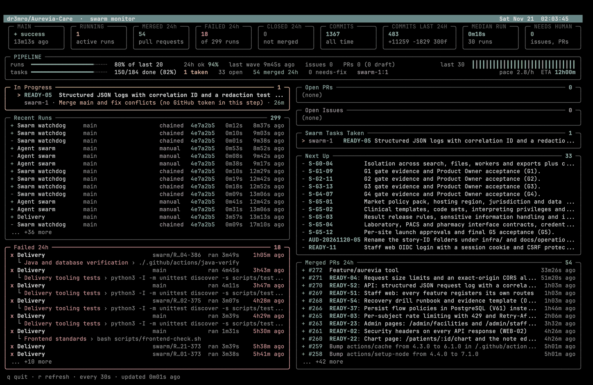

# Aurevia Care

Aurevia Care (Aurevia Cloud V1) is a multi-tenant healthcare platform: a Spring Boot API, a React staff web app and a React Native patient app, built by a team of OpenCode agents through GitHub Actions. The product specification is in `.opencode/config/PROJECT_V1_SPEC.md`, the task files in `tasks/`, and setup details in `.opencode/config/README-SETUP.md`.

## Run it with one command

The `aurevia` tool runs the whole platform from one Docker image: the staff web on port **3000**, the API on port **8080** and PostgreSQL inside the container.

```sh
curl -fsSL https://raw.githubusercontent.com/dr3mro/Aurevia-Care/main/install.sh | sh
```

Open <http://localhost:3000> for the staff web and <http://localhost:8080> for the API. The image runs with the `synthetic-auth` profile, so no identity provider is needed. Use synthetic data only.

Requirements: Apple `container` (preferred when installed, needs `python3`) or Docker, plus `curl`, and `git` and `python3` for the repository commands. Choose with `--runtime container|docker` or `AUREVIA_RUNTIME`. Apple `container` has no tmpfs option, so there the database sits on the container's disk and is wiped at every start; it also defaults to 1 GB of memory, so the tool passes `--memory 3` (change with `--memory GB`).

### Database and persistence

The database lives in memory and starts empty from the migrations in `db/migrations`. To keep it between runs, start with persistence:

```sh
aurevia run --persist
```

On a clean stop (`aurevia stop`) the database is saved to `~/.local/share/aurevia/dumps/<name>/persist.sql`; the previous save is kept as `persist.sql.prev`. The next start restores it and applies only the migrations it has not seen. Without `--persist` a stop discards the data.

### Commands

| Command | What it does |
|---|---|
| `aurevia run [tag]` | Create and start the container (pulls the image if it is missing). |
| `aurevia stop` / `restart` / `delete` | Stop (saving if persistent), restart or remove the container. |
| `aurevia status` | State, image, ports and health. |
| `aurevia logs [N]` | Last N log lines, then follow. |
| `aurevia shell` / `psql` | A shell or `psql` inside the container. |
| `aurevia dump [file]` | Write a SQL dump of the running database. |
| `aurevia restore <file>` | Use a dump as the saved database and restart. |
| `aurevia build [tag]` | Build the image from `Dockerfile.app`. |
| `aurevia check [quick\|worker\|full]` | Run the repository quality gates. |
| `aurevia test [api\|web\|mobile]` | Run one application's tests. |
| `aurevia monitor` | Open the swarm dashboard. |
| `aurevia todo` | Count open, taken and done tasks. |
| `aurevia doctor` | Check that the needed tools are installed. |
| `aurevia install` / `uninstall` | Update or remove the tool. |

Options: `--runtime`, `--memory`, `--cpus`, `--name`, `--image`, `--web-port`, `--api-port`, `-p/--persist`, `--no-persist`, `--repo`, `-n/--dry-run` and `-y/--yes`. Run `aurevia help` for the full text.

### Install options

`install.sh` accepts `--ref`, `--dir`, `--bin-dir`, `--no-rc`, `--uninstall` and `--replace`. It installs into `~/.local/share/aurevia`, links `aurevia` into `~/.local/bin`, and adds a marked PATH and tab-completion block to `~/.zshrc`, `~/.bashrc` (and `~/.bash_profile` on macOS). Running it again updates the tool. To install from a local checkout: `AUREVIA_SOURCE=. sh install.sh`.

## Swarm monitor

`aurevia monitor` opens a live terminal dashboard for the OpenCode agent swarm. It needs the GitHub CLI (`gh`, signed in) and `python3`, and refreshes every 60 seconds (the slow lists every 5 minutes) to stay well under the GitHub rate limit.



- **Top cards:** the state of `main`, active runs, merged PRs, failed runs, closed PRs, commits (all time and the last 24 hours, with lines added and removed), the median run time and items that need a person.
- **Pipeline:** success rate of the last 20 runs, tasks done against the total, open and taken tasks, merged PRs, the last wave, the pace per hour and an ETA.
- **In Progress:** each task a worker holds, with the worker, its current step and how long it has run.
- **Recent Runs and Failed 24h:** every run with its trigger, commit and duration; a failed run also names the job and step that failed.
- **Right column:** open PRs and issues, tasks taken by the swarm, the next tasks in line and the PRs merged in the last 24 hours.

Keys: `q` quits and `r` refreshes now. A new failed run rings the terminal bell until you press any key. Other options: `aurevia monitor --once` prints one snapshot, `--interval SECONDS` changes the refresh time and `--recent N` changes how many runs are listed.

The monitor also keeps the swarm running: when no Agent swarm run is queued or in progress and `tasks/` still has open tasks, it dispatches a wave (`gh workflow run swarm.yml`), at most once every 10 minutes. `--autostart-wait MINUTES` changes that gap and `--no-autostart` turns it off. `--once` never starts a wave.

### Force a task

To start one task now, ahead of the queue, dispatch the swarm with its id (needs `gh`, signed in):

```
gh workflow run swarm.yml --ref main -f task=FIX-INSTANT-OPENAPI -f now=true -f workers=1
```

Replace `FIX-INSTANT-OPENAPI` with any task id from `tasks/`. See "Forcing a task" in `docs/SWARM.md` for what it overrides.

## The image

`Dockerfile.app` builds the single image in three stages: the staff web (`npm run build`), the API (a runnable Spring Boot jar) and a PostgreSQL 17 base that adds nginx and Java. `infra/app/start.sh` starts PostgreSQL, applies the migrations, then starts the API and nginx. nginx serves the web on 3000 and proxies `/api` to the API.

```sh
aurevia build            # or: docker build -f Dockerfile.app -t aurevia-app .
aurevia run
```

The original `Dockerfile` is the release rehearsal image used by the Delivery workflow and is separate.

### Release from a tag

Pushing a `v*` tag runs the release workflow, which builds the image on native amd64 and arm64 runners, smoke-tests it, and publishes `ghcr.io/dr3mro/aurevia-care-app:<version>` and `:latest`:

```sh
git tag v0.1.0 && git push origin v0.1.0
```

The workflow file is `.github/workflows/release-app-image.yml`.

## Development

- `bash scripts/quick-check.sh` is the fast gate. `bash scripts/worker-check.sh` adds PostgreSQL integration tests, the frontend standards gate and SpotBugs. `bash apps/api/check.sh` is the full Java gate with coverage.
- Applications: `apps/api` (Spring Boot), `apps/staff-web` (React, Vite), `apps/patient-mobile` (React Native, Expo).
- Tasks, agent rules and the swarm: `tasks/`, `.opencode/setup/AGENTS.md`, `docs/SWARM.md`. Watch the swarm with `scripts/monitor.sh`.
