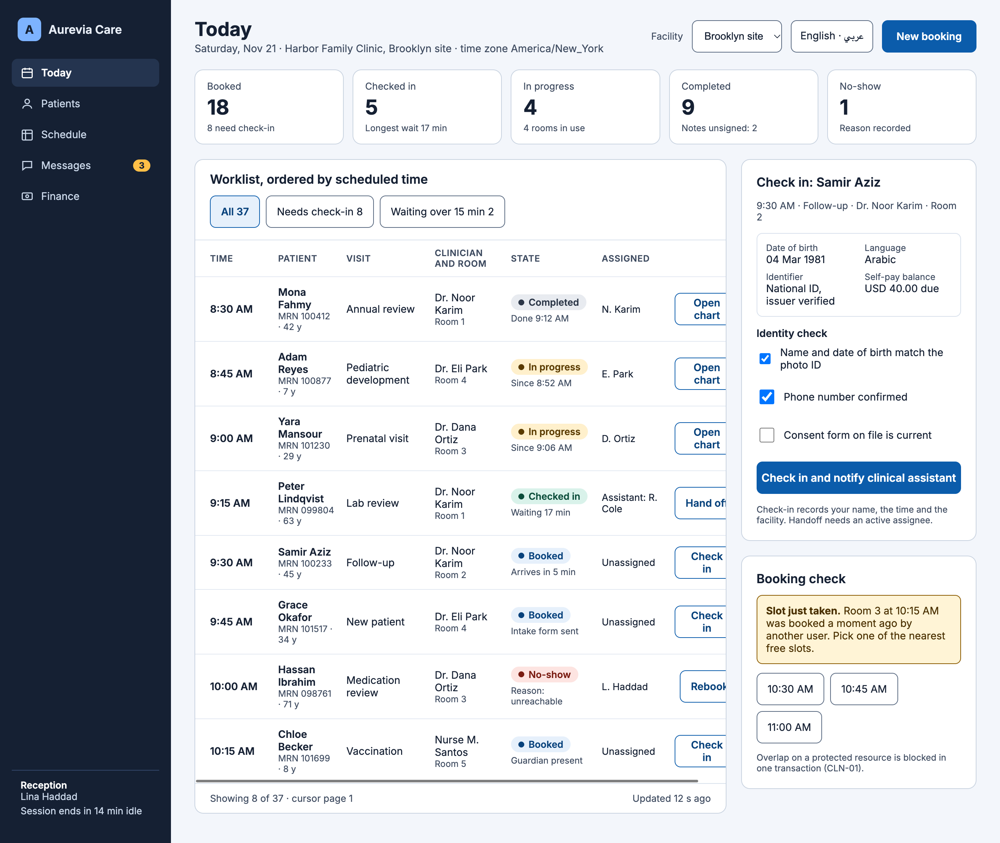
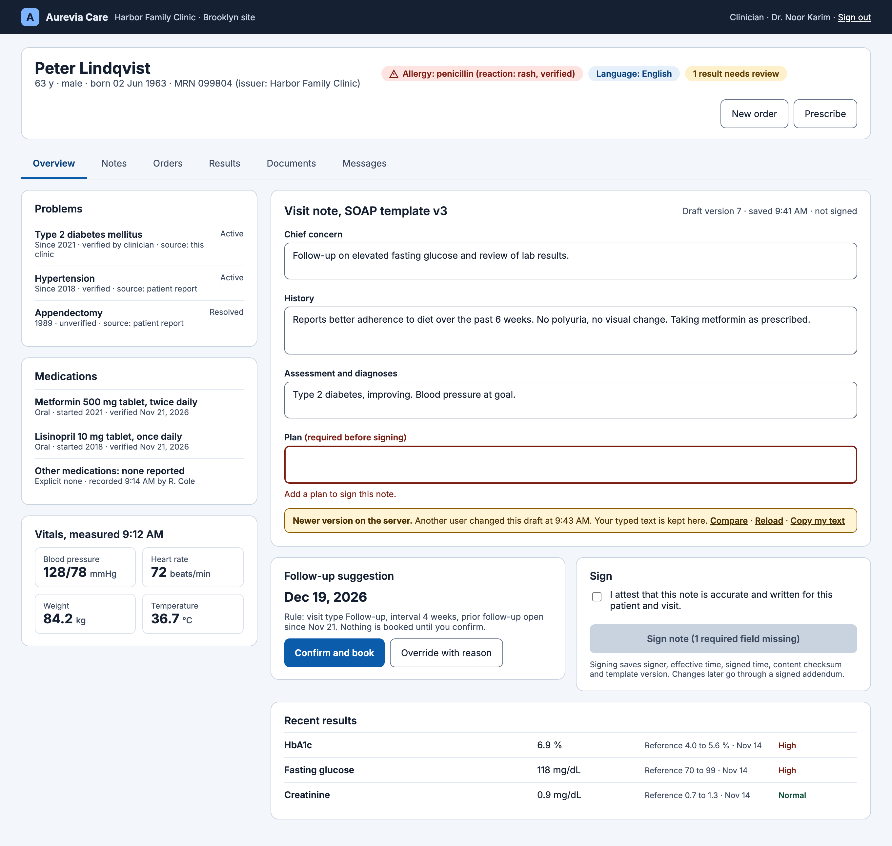
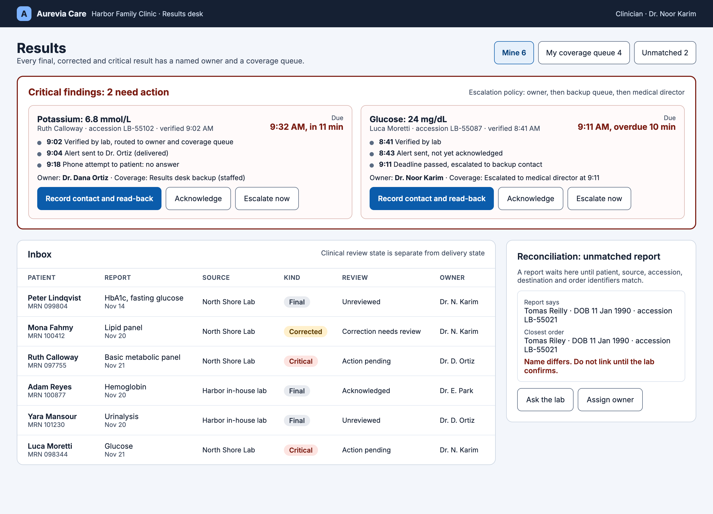
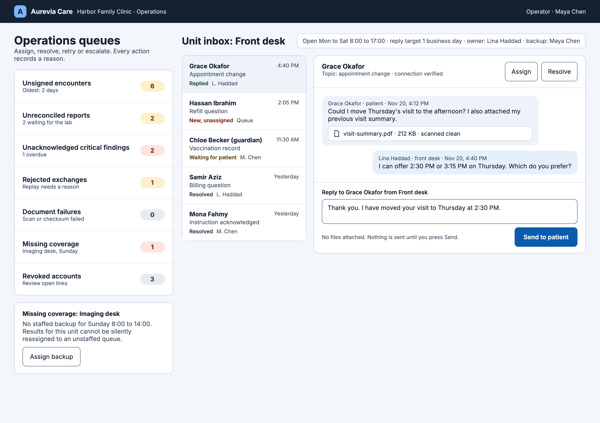
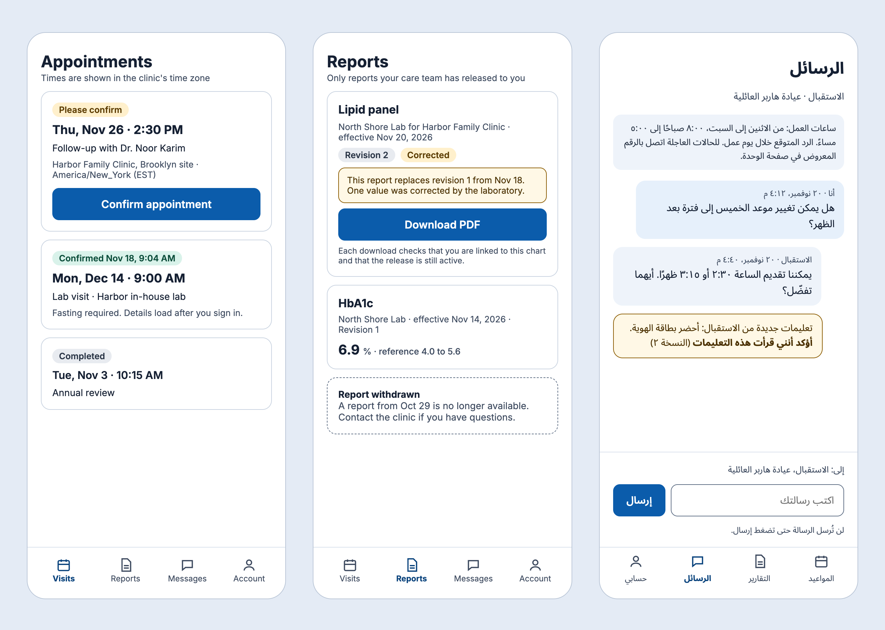

# Approved screen designs

- Requirements: UX-01, CLN-01 to CLN-06, XCH-04, XCH-05, ADM-02, MSG-02, MSG-06, PAT-01, PAT-02
- Status: reviewed against the specification. Pictures are a prediction of the finished screens, not a contract; the specification and the token contract win where they differ.
- Audience: workers and maintainers building or changing these screens.

Each section has the picture, the screen's page layout in words (for a reader that cannot view images) and where the code lives. The words and the picture describe the same screen. For colours, spacing and type use the [token contract](../token-contract.md), never the pictures. For the states every screen must show, the folder layout and the tests, follow the [screen recipe](../screen-recipe.md).

Rules the pictures share:

- A state is always shown with a word or an icon as well as colour.
- Touch and click targets are at least 44 px (48 px in the patient app).
- The layout uses logical properties so the Arabic version mirrors; the pictures show English except the third patient screen.
- Where a table is wider than its card, the card scrolls sideways. The reception picture clips its last column; build it to scroll or fit.
- Names are synthetic. Never copy a name, number or value from a picture into a fixture that looks like real data.

## Reception: today's worklist and check-in

- Requirements: CLN-01, CLN-02
- Code: `apps/staff-web/src/features/scheduling`
- Backlog task: BUILD-67 in tasks/

A dark navigation column about 230 px wide on the left (Today is the active item; then Patients, Schedule, Messages with an unread badge, Finance; at the bottom the user's role, name and the idle-session countdown). The content sits on a light page background. At the top: the title Today, a line with the date, the facility name and its time zone, and on the right a facility select, a language switch (English and Arabic) and a primary New booking button. Under it a row of five equal white cards, one per state (label, large number, small note). Under that two columns: a wide white card with the worklist (a heading and three filter chips on top, then the table, then a footer with the row count and the last update time) and a narrow column (320 to 420 px) with two cards, Check-in and Booking check (the second holds an amber alert and three slot buttons). A state badge is a pill with a small dot and the state word: booked blue tint, checked in green tint, in progress amber tint, completed gray, no-show red tint; the word is always shown. When the screen is narrow the columns stack and the navigation moves to the top. Use design tokens, never raw colours. Touch targets are at least 44 px (48 px on the phone). Show state with a word or icon as well as colour.

## Clinician: patient chart and note

- Requirements: CLN-03, CLN-05, CLN-06
- Code: `apps/staff-web/src/features/chart`
- Backlog task: BUILD-68 in tasks/

A dark top bar (no side navigation) with the clinic and site on the left and the user on the right. Below it a full-width white patient banner: the name in large type, a line with age, sex, date of birth and MRN with its issuer, then chips (a red allergy chip with a warning icon, a blue language chip, an amber results-to-review chip) and the buttons New order and Prescribe on the right. Under the banner a tab row (Overview active with a blue underline). Then two columns. Left, 320 to 440 px, three stacked cards: Problems (rows with name, a small meta line and a state on the right), Medications (name and meta lines) and Vitals (a two-by-two grid of tiles, each with a small label and a large value followed by its unit). Right, wide: the note card (title with the template and version on the left, draft version and save time on the right; four labelled multi-line fields; the Plan field has a red border and a red error line below it; an amber box with the stale-version message and three links), then two cards side by side, Follow-up suggestion (a large date, the rule in small text, two buttons) and Sign (an attestation checkbox, a gray disabled Sign button, small explanatory text), then the Recent results card with rows of test, value, reference range with date, and a flag word in colour. Use design tokens, never raw colours. Touch targets are at least 44 px (48 px on the phone). Show state with a word or icon as well as colour.

## Results inbox and critical queue

- Requirements: XCH-04, XCH-05
- Code: `apps/staff-web/src/features/results`
- Backlog task: BUILD-69 in tasks/

A dark top bar. A heading Results with a one-line subtitle on the left and three filter chips (Mine, My coverage queue, Unmatched) on the right. Then one full-width white card with a thick red border titled in red Critical findings with the count that need action, and the escalation policy in small text on the right. Inside it two light-red cards side by side: each has the test and value in bold with the patient, accession and verified time under it, a Due label with the time in bold red on the right (and the overdue wording when late), an event list with a small dot and a bold time per line, an owner and coverage line, and three buttons (the primary Record contact and read-back, then Acknowledge and Escalate now as outlines). Below that two columns: a wide Inbox card (title, a small note that review state is separate from delivery state, a table with Patient and MRN, Report and date, Source, a Kind pill for final, corrected or critical, Review state, Owner) and a narrow Reconciliation card (a title, one explanatory line, a bordered box with a Report says line and a Closest order line and a bold red warning line, then the buttons Ask the lab and Assign owner). Use design tokens, never raw colours. Touch targets are at least 44 px (48 px on the phone). Show state with a word or icon as well as colour.

## Operations queues and unit inbox

- Requirements: ADM-02, MSG-02, MSG-06
- Code: `apps/staff-web/src/features/operations` and `features/messages`
- Backlog task: BUILD-70 in tasks/

A dark top bar. Two columns. Left, 320 to 460 px: the title Operations queues with a subtitle; a white card holding seven full-width rows, each with the queue name in bold, a small note under it and a count pill on the right (red for urgent, amber for waiting, gray for calm); under it a card for missing coverage with a short explanation and an Assign backup button. Right, wide: the heading Unit inbox with the unit name and a small bordered strip with service hours, reply target, owner and backup. Under it two parts side by side: a thread list card 280 to 340 px wide (each row has the patient name and time, the topic, then a coloured state word and the owner; the open thread has a light blue background) and the conversation card. The conversation card has a header (patient, topic, connection verified, Assign and Resolve buttons), message bubbles (the patient's on the left in light blue-gray with sender role and time, an attachment chip with file name, size and scan result inside it; the staff reply on the right in light blue) and at the bottom a labelled composer: Reply to the patient from the unit, a text area, a small hint on the left and a primary Send button on the right. Use design tokens, never raw colours. Touch targets are at least 44 px (48 px on the phone). Show state with a word or icon as well as colour.

## Patient app: appointments, reports and messages (English and Arabic)

- Requirements: PAT-01, PAT-02, MSG-06, UX-01
- Code: `apps/patient-mobile/src/features/appointments`, `reports` and `conversations`
- Backlog task: BUILD-71 in tasks/

Three phone-sized screens, each 390 by 844 px with rounded corners and no fake status bar. Each has a large bold title and a one-line subtitle at the top, cards with about 14 px radius in the middle, and a bottom tab bar with four icon-and-label tabs (Visits, Reports, Messages, Account; the active one is bold blue). Screen one, Appointments: each card has a status pill at the top-left (Please confirm in amber, Confirmed with the time in green, Completed in gray), the date and time in large type, the clinician or visit line, a small line with the facility and its time zone, and a full-width primary Confirm button on the card that needs it. Screen two, Reports: a card with the title, issuing organization and effective date, pills for Revision and Corrected, an amber note box about the correction, a full-width primary Download PDF button and a small text about the per-download check; a second card with a result value; and a dashed-border notice for a withdrawn report. Screen three is Arabic and right-to-left: the title الرسائل, the unit name, a blue-gray info box with the service hours and reply target, mirrored message bubbles (own messages on the starting side), an amber instruction card with the acknowledgment sentence and its revision, then at the bottom a To line, a text input with a primary send button (إرسال) and a small note that nothing is sent until the button is pressed; the tab bar is mirrored with the labels المواعيد, التقارير, الرسائل and حسابي. Use design tokens, never raw colours. Touch targets are at least 44 px (48 px on the phone). Show state with a word or icon as well as colour.
