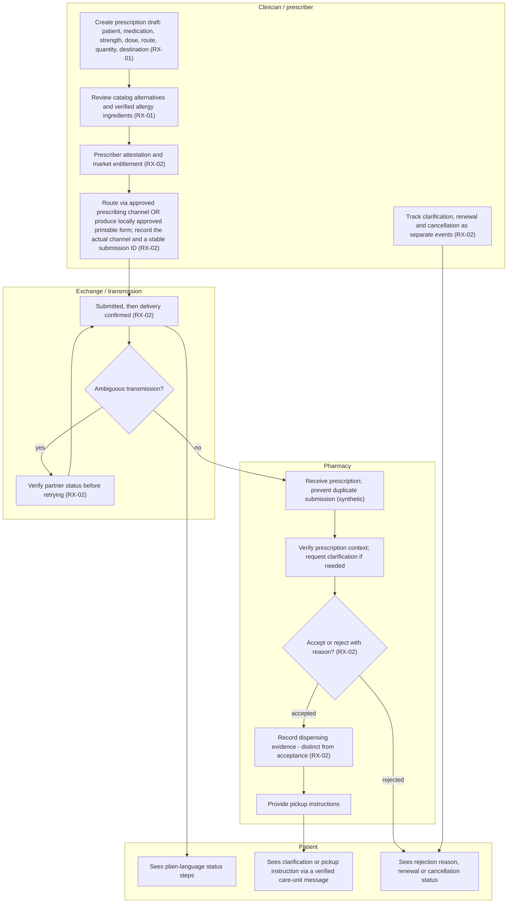
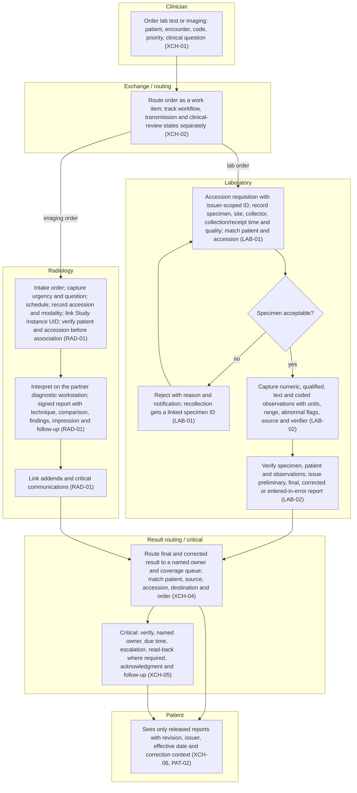

# Care loop: prescription, laboratory and imaging

- Requirements: **RX-02**, **LAB-01**, **RAD-01** (supporting RX-01, LAB-02,
  XCH-01, XCH-02, XCH-04, XCH-05, XCH-06, PAT-02, MSG-01 and MSG-02).
- Status: documentation handoff. This page describes the intended V1 workflow;
  it is not clinical approval. Real-site enablement of channels and any patient
  release remain human, site-specific gates (G5).
- Audience: clinicians and prescribers, pharmacy, laboratory and radiology
  operators, patient-facing product, QA and reviewers.
- Data: synthetic only. No real patient, identifier, prescription or credential
  appears here.

This directory gives one view of the end-to-end care loop across five roles —
**clinician, pharmacy, laboratory, radiology and patient** — for two journeys:

1. The **prescription loop** (RX-02): from a signed prescription to pharmacy
   acceptance and dispensing evidence.
2. The **lab and imaging loop** (LAB-01, RAD-01): from an order to a verified,
   released result.

The authoritative clauses are in the
[product specification](../../../.opencode/config/PROJECT_V1_SPEC.md). No new requirement or
threshold is introduced by this handoff.

## Requirement mapping

| Requirement | Clause summarised | Where it appears |
|---|---|---|
| RX-01 | Draft fields, versioned drug catalog, allergy check | Prescription diagram, steps 1–2 |
| RX-02 | Attestation, market entitlement, approved channel or printable form, stable submission ID, separate submitted/delivery/accepted/rejected/clarification/renewal/cancellation events, dispensing evidence distinct from acceptance, verify-before-retry | Prescription diagram, steps 2–6 |
| LAB-01 | Issuer-scoped accession ID, specimen/site/collector/times/quality, patient and accession matching, rejection with reason, linked recollection | Lab and imaging diagram, steps 7–8 |
| LAB-02 | Observation capture with units/range/flags/verifier, verification, report states | Lab and imaging diagram, step 9 |
| RAD-01 | Order intake, urgency and question, scheduling, accession and modality, Study Instance UID, patient/accession verification, partner workstation, signed interpretation, addenda, critical communications, partner access control | Lab and imaging diagram, step 11 |
| XCH-01, XCH-02 | Order content and separate workflow/transmission/review states | Both diagrams |
| XCH-04, XCH-05 | Result routing to a named owner, critical-result escalation and acknowledgment | Lab and imaging diagram, step 10 |
| XCH-06, PAT-02 | Separate patient-release authorization; released report shows revision, issuer, effective date and correction context | Lab and imaging diagram, step 12 |
| MSG-01, MSG-02 | Verified care-unit connection and scoped messaging for clarifications and pickup instructions | Step table, step 6 |

## Diagram 1 — Prescription loop (RX-02)

Swimplanes are the subgraphs: clinician, the exchange/transmission boundary,
pharmacy and the patient.

## Diagram 2 — Lab and imaging loop (LAB-01, RAD-01)

Swimlanes are the subgraphs: clinician, exchange, laboratory, radiology, result
routing and patient.

Images stay under partner access control (RAD-01); this loop links studies and
reports but does not copy images into the patient chart.

## Role-by-step table

"Patient sees" is limited to content approved for patient display. A staff
status change, a transmission acknowledgment or a clinician's review is **not**
automatically patient-visible: patient release is a separate authorization that
references an immutable revision (XCH-06, PAT-02).

| # | Loop | Clinician | Pharmacy | Laboratory | Radiology | What the patient sees |
|---|---|---|---|---|---|---|
| 1 | Prescription | Creates a prescription draft and checks catalog alternatives and verified allergies (RX-01). | — | — | — | Nothing yet; a draft is not released. |
| 2 | Prescription | Attests as prescriber and confirms market entitlement (RX-02). | — | — | — | Nothing yet. |
| 3 | Prescription | Chooses an approved prescribing channel or a locally approved printable form; records the actual channel and a stable submission ID (RX-02). | — | — | — | "Sent to pharmacy" step. |
| 4 | Prescription | Watches delivery; on an ambiguous transmission verifies partner status before retrying (RX-02). | Receives the prescription, de-duplicates the submission and verifies its context. | — | — | "Delivery confirmed" step; no pharmacy decision is implied yet. |
| 5 | Prescription | Answers clarification requests. | Accepts or rejects with a reason and requests clarification if needed (RX-02). | — | — | "Pharmacy accepted", "rejected — reason" or "clarification needed". |
| 6 | Prescription | Records renewal and cancellation as events separate from acceptance (RX-02). | Records dispensing evidence, distinct from acceptance (RX-02), and gives pickup instructions. | — | — | Renewal/cancellation status and pickup instructions via a verified care-unit message (MSG-01, MSG-02). |
| 7 | Lab | Orders a lab test with patient, encounter, code, priority and clinical question (XCH-01). | — | Accessions the requisition with an issuer-scoped ID and records specimen, site, collector, times and quality (LAB-01). | — | "Ordered" step. |
| 8 | Lab | — | — | Matches patient and accession at collection and receipt; rejects a bad specimen with reason and notification; a recollection gets a linked specimen ID (LAB-01). | — | "Sample taken" step; a rejection reason if one was recorded. |
| 9 | Lab | — | — | Captures observations with units, range, flags, source and verifier; verifies specimen, patient and observations (LAB-02). | — | "Result ready for your doctor" step; not yet released. |
| 10 | Lab / imaging | Reviews the final or corrected result routed to the named owner and coverage queue (XCH-04); verifies and acknowledges critical findings (XCH-05). | — | Issues preliminary, final, corrected or entered-in-error reports (LAB-02). | Signs the interpretation and links addenda and critical communications (RAD-01). | No new view from a staff review or acknowledgment; release is still a separate act. |
| 11 | Imaging | Orders imaging with priority and clinical question (XCH-01). | — | — | Intakes the order, schedules, records accession and modality, links the Study Instance UID and verifies patient/accession before association (RAD-01); images remain under partner access control. | "Ordered / scheduled" step. |
| 12 | Release | Authorizes patient release of a specific immutable revision (XCH-06). | — | — | — | Released report showing revision, issuing organization, effective date and correction context (PAT-02); a correction updates current access and retains history. |

## Boundaries

- Synthetic data only; no real patient, prescription, specimen or image is
  described. No credential or identifier appears in this directory.
- Documentation only. No application code, schema, API contract, CI or tracker
  file is in scope; this directory is the only file area changed.
- No clinical or human acceptance is implied. Site approval of prescribing
  channels, partner contracts and real-patient release remain separate gates.
- The exact plain-language labels in the patient "Where is it?" tracker are
  owned by the patient-app tracker story; this page fixes the sequence and the
  safety rule that only released steps appear, not the final copy.

## Verification

| Check | Command | Proves |
|---|---|---|
| Links and requirement IDs | `python3 -I scripts/check-docs.py` | Relative links resolve and every requirement ID used here is defined in the specification |
| Folder and package names | `python3 -I scripts/check-names.py` | The new directory is named after its business domain, not a task or requirement ID |
| Credential and PHI shapes | `python3 -I scripts/check-secrets.py` | No credential or patient-identifier pattern was introduced |
| Repository gate | `bash scripts/check.sh` | The workspace gates pass with this documentation added |

## Evidence source

Requirements and workflow steps were taken from the
[product specification](../../../.opencode/config/PROJECT_V1_SPEC.md) and the existing
operations documentation style. Clinical-role framing was informed by the
simulated pharmacy, laboratory, radiology, patient and physician reviewer
skills. This is executed-tool plus simulated-review evidence only: there was
**no** simulated-user run, human participant or authorized clinical pilot
evidence for this documentation story.
