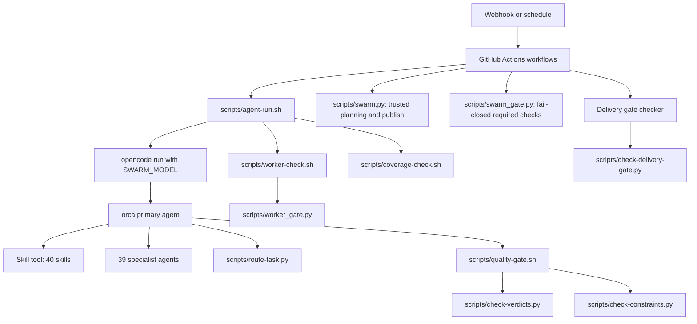
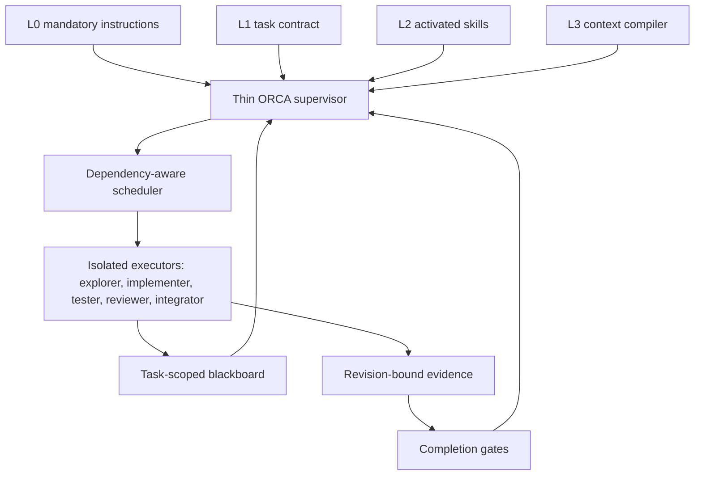

# ORCA Stage A inventory and current architecture

Evidence in this document comes from read-only tool calls and four concurrent read-only specialist passes. Exact `file:line` citations and per-item dispositions are in `tasks/01300000-ORCA-INFRASTRUCTURE-REFACTOR.md`. No Git, `gh` or GitHub API call was made.

## Current architecture

The runtime profile installed by `scripts/agent-run.sh` differs from the committed generated profile (`scripts/gen-opencode.py:112-115`, `agent-run.sh:288-310`); this is the known OPS-CW-003-01 false-positive source.

## Target architecture (draft)

This is a draft, not an approved target: the isolation, model-policy and evidence-boundary parts depend on the owner decisions recorded in `.opencode/config/MEMORY.md`.

## Instruction inventory

| Layer | Files | Loaded natively |
|---|---|---|
| Always-on | `.opencode/setup/AGENTS.md`, `.opencode/setup/CODING_STYLE.md`, `.opencode/config/README-SETUP.md`, `docs/WORKFLOW.md` | Yes, identical 4-entry arrays at `opencode.json:4-9` and `opencode.ci.json:4-9` |
| Manual rules | `tasks/_head.md:25-43`, `.opencode/agents/orca.md:6,36,40,42`, `.opencode/setup/CONSTRAINTS.md` | No; read by instruction |
| Spec and trackers | `.opencode/config/PROJECT_V1_SPEC.md`, `MEMORY.md`, `WORKSPACE.md`, `BUGS.md`, `PROJECT.md` | No; by requirement ID |
| Skill bodies | 40 files under `.opencode/skills/*/SKILL.md` | Advertised by description; body on `skill` tool call |

Broken references confirmed by tool in the **pre-repair Stage A baseline**: root `AGENTS.md` (cited by `README.md` and `tasks/_head.md`), root `PROJECT_V1_SPEC.md` (cited by `README.md` and `AGENTS.md`), `docs/archive/PROGRESS.md` (cited by `WORKSPACE.md`), and the singular `.agent/` path (cited by `AGENTS.md`) while the tree is `.agents/`. These references were repaired in the same change that produced this inventory; `scripts/tests/test_instruction_paths.py` is the regression guard that asserts the canonical paths are present and the retired ones are absent, so the original citations no longer describe the current tree. Links inside `README.md`, `README-SETUP.md`, the PR template, `docs/design/`, `db/migrations/` and `contracts/` resolve. No skill body is manually re-read; `aurevia-delivery` is advertised and explicitly invoked, which is a reinvocation, not a duplicated file read.

## Agent and skill inventory

- 39 agent files under `.opencode/agents/` and 39 matching config keys; all have a `description:` at line 2; `orca.md:3` is `mode: primary`.
- 40 skills: 39 named `aurevia-*` plus `run-workflow` (`.opencode/skills/run-workflow/SKILL.md:2`). Directory name equals frontmatter `name:` for all 40; no duplicate names. The assertion that every skill has the product prefix is disproven by `run-workflow`.
- Skill IDs are part of the advertised routing contract in this session; renaming them (ORCA-081) requires an atomic rename plus config regeneration and discovery validation, and is staged, not started.

## Script ownership inventory

| Owner | Present today | Examples |
|---|---|---|
| GitHub automation | No `.github/script/` directory; workflows call flat `scripts/` entry points | `swarm.yml` → `scripts/swarm.py`; `fix-pr-gate.yml` → `scripts/check.sh`, `scripts/swarm.py fail`; `swarm-gate.yml` → `scripts/swarm_gate.py evaluate` |
| OpenCode orchestration | No `.opencode/scripts/` directory | `scripts/route-task.py`, `scripts/gen-opencode.py`, `scripts/check-pack.py`, `scripts/agent-run.sh` |
| Project tooling | Flat `scripts/` rather than the proposed subdirectories | 20 Python scripts, 17 Bash scripts, `scripts/wiring-baseline.json`, ~75 modules in `scripts/tests/` |

No circular imports were found. Duplication to resolve in Stage D: `parse_tasks` at `scripts/monitor.py:287` and `scripts/swarm.py:2212`; Git wrappers at `swarm.py:256` and `check-constraints.py:84`; overlapping failure classifiers at `failure_classes.py:52`, `swarm.py:607,752`. `failure_classes.py` has no production caller.

## Workflow inventory

21 workflow files. Delivery jobs and dependencies (source-verified): `policy` → `script-tests` → `frontend` → `java-verify` → `docs` → `verify` → `release` → `gate`; `gate` needs all seven with `if: always()` and calls `scripts/check-delivery-gate.py`. Queueing gates use `queue: max` with `cancel-in-progress: false`; no workflow sets `cancel-in-progress: true`. Write tokens are separated from agent steps that handle untrusted output in every path read.

WF-22 and WF-23 are disproven: there is no fallback model and no `SWARM_FORCE_MODEL` implementation, by the owner decision at `.opencode/config/MEMORY.md:33`. Live GitHub, ruleset, merge-queue and exact-SHA evidence is unavailable in this session and stays blocked.

## Baseline measurements

Globally loaded instruction documents total 183,008 bytes over 901 lines; agent Markdown totals 14,331 bytes; skill Markdown totals 96,998 bytes. These are character counts, not token counts: no tokeniser is available, so ORCA-002 token metrics are reported as unavailable rather than estimated. Verified commands: `python3 -I scripts/gen-opencode.py --check` exit 0; `python3 -I -m unittest discover -s scripts/tests -p 'test_gen_opencode*.py' -q` ran 23 tests in 0.483 s, OK; `shellcheck --version` 0.11.0; local `opencode --version` v2.4.0 while the agent image pins 2.4.1 at `.github/agent-image/Dockerfile:10`.
